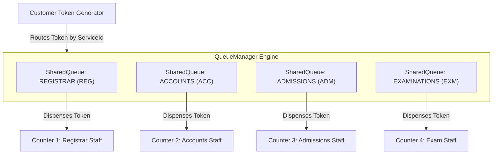
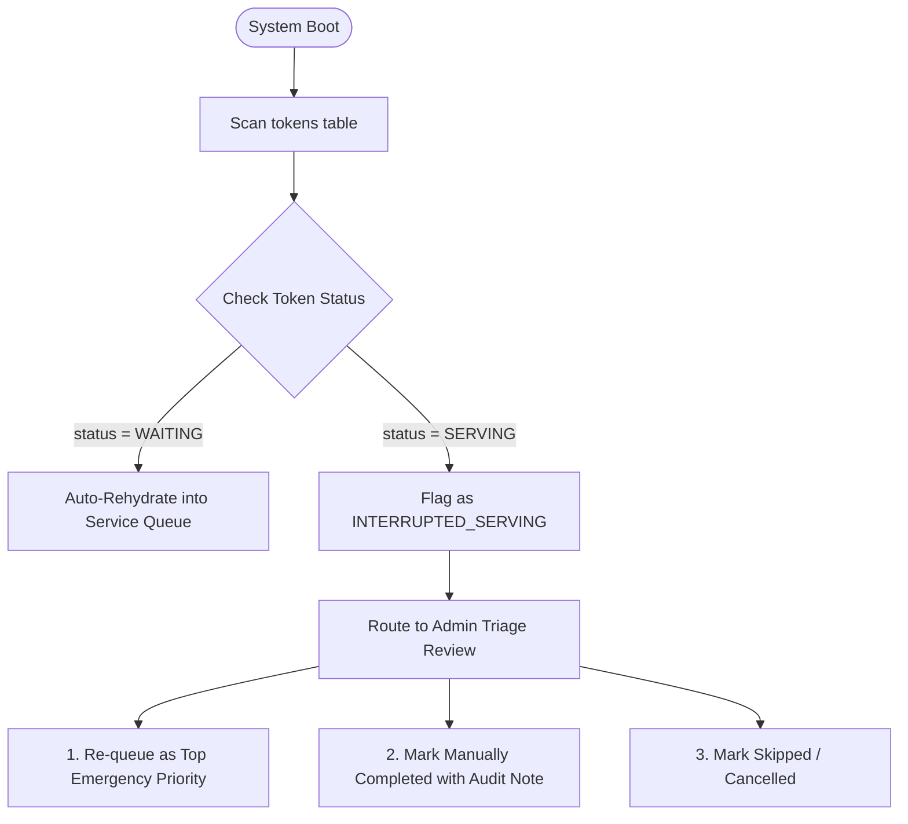
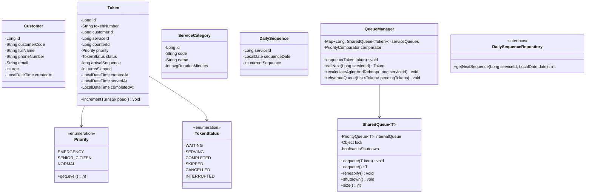

# QFlow – Software Architecture Document (SAD)
## Phase 1: Complete System Architecture & UML Design (Version 1.1 - FROZEN)

**Document Version:** 1.1.0  
**Status:** FROZEN – INCORPORATED CORE ARCHITECTURAL CORRECTIONS  
**Architecture Style:** 6-Layer Clean Architecture  
**Target Environment:** College Administration Office Simulation  

---

## 1. Architectural Style & Layered Model

QFlow enforces a **6-Layer Clean Architecture** pattern. Dependencies flow strictly **downward and inward**. Outer layers depend on inner layers; inner layers never know about outer layers.

```
+-----------------------------------------------------------------------------------+
| 1. PRESENTATION LAYER (CLI / Dual-Mode Console)                                   |
|    - Mode A: Operational CLI (CustomerKioskUI, CounterOperatorUI, AdminConsoleUI) |
|    - Mode B: Automated Concurrency Simulation (Producer-Consumer Monitor Tester)  |
+-----------------------------------------------------------------------------------+
                                         │  (invokes)
                                         ▼
+-----------------------------------------------------------------------------------+
| 2. SERVICE / BUSINESS LOGIC LAYER                                                 |
|    - CustomerService | TokenService | QueueService | AnalyticsService | TriageService|
+-----------------------------------------------------------------------------------+
                      │                                      │  (calls interfaces)
                      ▼                                      ▼
+--------------------------------------+   +----------------------------------------+
| 3. DOMAIN / MODEL LAYER (POJOs)      |   | 4. REPOSITORY / DAO LAYER (Interfaces) |
|    - Customer | Token | ServiceCategory|   |    - CustomerRepository | TokenRepository  |
|    - Priority | TokenStatus | Counter|   |    - ServiceRepository  | HistoryRepository  |
|    - DailySequence                   |   |    - DailySequenceRepository           |
+--------------------------------------+   +----------------------------------------+
                                                             │  (implemented by)
                                                             ▼
                                           +----------------------------------------+
                                           | 5. REPOSITORY IMPL & DATABASE LAYER    |
                                           |    - CustomerDAOImpl | TokenDAOImpl    |
                                           |    - DailySequenceDAOImpl              |
                                           |    - DBConnection (JDBC Driver)        |
                                           +----------------------------------------+
                                                             │  (executes SQL on)
                                                             ▼
                                           +----------------------------------------+
                                           | 6. DATABASE: MySQL 8 (ACID Source)     |
                                           +----------------------------------------+
```

---

## 2. Core Architectural Decisions (Incorporated Corrections)

### 2.1 Decision 1: Four Partitioned Logical Service Queues
Instead of a monolithic queue where counters compete for irrelevant tokens, `QueueManager` manages **four dedicated, partitioned logical queues**:
1. `REG_QUEUE` – Registrar & Academic Transcripts
2. `ACC_QUEUE` – Accounts & Fee Payments
3. `ADM_QUEUE` – Admissions & Document Verification
4. `EXM_QUEUE` – Examination & Grade Cards

Each service queue is an independent, thread-safe `SharedQueue<Token>` instance guarded by its own dedicated object monitor lock. Counter operators subscribe only to their assigned service queue(s), eliminating cross-service lock thrashing and avoiding queue-filtering overhead.



---

### 2.2 Decision 2: Daily, Service-Specific Token Numbering
Token numbers must be human-readable, service-specific, and reset daily at `00:00:00` without colliding across crashes.

- **Standard Token Format:** `TKN-<SERVICE_CODE>-<YYYYMMDD>-<DAILY_SEQUENCE>`
  - Examples: `TKN-ACC-20261118-0001`, `TKN-REG-20261118-0042`
- **Persistence Strategy:** A dedicated database table `daily_service_sequences (service_id, sequence_date, current_sequence)` acts as the persistent allocator.
- **Concurrency & Restart Safety:** Sequence increments execute via atomic database row updates (`INSERT ... ON DUPLICATE KEY UPDATE current_sequence = current_sequence + 1`). Even if the JVM restarts 10 times in a single day, sequence continuity is mathematically preserved.

---

### 2.3 Decision 3: Priority Aging with Controlled Heap Recalculation
In Java, modifying mutable properties of objects stored within a `java.util.PriorityQueue` **does not trigger re-heapification**, leading to stale sorting bugs.

To guarantee that priority escalation for starved `NORMAL` customers takes effect safely:
1. **Aging Evaluation Invariant:** Every token tracks `createdAt` and `turnsSkipped` (incremented whenever a higher-priority token bypasses it).
2. **Controlled Recalculation Protocol:**
   - Aging recalculation is **not** performed continuously or asynchronously.
   - It is triggered inside a **controlled monitor block** during dispatch:
     - When `callNext(serviceId)` is invoked, `QueueManager` evaluates whether any waiting `NORMAL` token has exceeded the aging threshold (e.g., 20 minutes wait time or 5 higher-priority turns).
     - If aging conditions are met, the token's effective priority is elevated to `SENIOR_CITIZEN` weight, and the affected `PriorityQueue` executes a controlled in-monitor heap re-establishment (remove and re-insert under lock), guaranteeing 100% sorting validity without heap corruption.

---

### 2.4 Decision 4: Administrator Review for Tokens Interrupted in SERVING
During crash recovery and startup reconciliation:
- Tokens in `WAITING` state are automatically queried and re-enqueued into their respective service queues.
- Tokens found in `SERVING` state at boot time were abruptly interrupted mid-service (e.g. power failure or JVM kill).
- **Automated re-enqueue is strictly forbidden** for interrupted tokens because the student might have already left, or the clerk might have finished the paperwork offline.
- **Admin Triage Protocol:**
  1. Boot sequence flags all `SERVING` tokens as `INTERRUPTED_SERVING`.
  2. The Administrator Console provides an **Interrupted Service Triage Screen**.
  3. The Administrator decides one of three audited actions:
     - **Re-queue with Top Priority:** Assign immediate `EMERGENCY` priority to serve the displaced student first.
     - **Mark Completed:** Confirm manual completion offline and record service history.
     - **Mark Skipped / Cancelled:** Confirm customer departure and clear the record.



---

### 2.5 Decision 5: Dual Execution Modes (Operational CLI + Concurrency Simulation)
To satisfy both practical real-world usage and the academic syllabus evaluation:
1. **Mode A: Operational CLI Mode**
   - The interactive production console.
   - Customer Kiosk for registration and token printing.
   - Staff Counter Console for calling, serving, skipping, and completing tokens.
   - Administrator Console for queue monitoring, triage review, and Stream API analytics.
2. **Mode B: Automated Concurrency Simulation Mode**
   - Dedicated multithreaded test harness.
   - Spawns configurable `TokenProducer` threads (simulating incoming student bursts across all 4 services).
   - Spawns configurable `TokenConsumer` threads (simulating counter clerks with realistic variable processing delays).
   - Visually logs guarded `wait()`, `notifyAll()`, queue capacity limits, and clean thread interruption/shutdown on the terminal.

---

## 3. UML Package & Namespace Structure

```
com.qflow/
├── app/                          # Entrypoint & CLI Presentation (Member 1 & 4)
│   ├── QFlowApp.java             # Main runner (Mode Selection: CLI vs Simulation)
│   ├── cli/
│   │   ├── CustomerKioskView.java
│   │   ├── CounterOperatorView.java
│   │   ├── AdminConsoleView.java
│   │   ├── AdminTriageView.java  # Decision 4: Interrupted token triage
│   │   └── ConsoleUtils.java
│   └── sim/
│       └── ConcurrencySimulationHarness.java # Decision 5: Concurrency demo
├── model/                        # Domain Entities & Enums (Member 1 - Owned)
│   ├── Customer.java
│   ├── Token.java
│   ├── ServiceCategory.java      # REG, ACC, ADM, EXM
│   ├── Counter.java
│   ├── ServiceHistory.java
│   ├── DailySequence.java        # Decision 2: Daily persistent sequences
│   └── enums/
│       ├── Priority.java
│       └── TokenStatus.java      # WAITING, SERVING, COMPLETED, SKIPPED, CANCELLED, INTERRUPTED
├── queue/                        # In-Memory Queue Engine (Member 2 - Owned)
│   ├── QueueManager.java         # Decision 1: Manages 4 partitioned queues
│   ├── ServiceQueueRegistry.java # Map<Long, SharedQueue<Token>>
│   ├── PriorityComparator.java   # Decision 3: Aging-aware comparator
│   └── QueueMetrics.java
├── service/                      # Business Logic Layer (Member 1, 2, 4)
│   ├── CustomerService.java      # Member 1
│   ├── TokenService.java         # Member 1 (Issues daily service tokens)
│   ├── QueueService.java         # Member 2
│   ├── TriageService.java        # Member 2/3 (Interrupted token workflow)
│   └── AnalyticsService.java     # Member 4
├── repository/                   # Data Access Contracts & Generics (Member 3 - Owned)
│   ├── CrudRepository.java       # Generic base interface <T, ID>
│   ├── CustomerRepository.java
│   ├── TokenRepository.java
│   ├── ServiceRepository.java
│   ├── ServiceHistoryRepository.java
│   ├── DailySequenceRepository.java # Decision 2: Sequence persistence
│   └── impl/                     # JDBC Implementations
│       ├── CustomerDAOImpl.java
│       ├── TokenDAOImpl.java
│       ├── ServiceDAOImpl.java
│       ├── ServiceHistoryDAOImpl.java
│       └── DailySequenceDAOImpl.java
├── database/                 # JDBC Infrastructure (Member 3 - Owned)
│   ├── DBConnection.java
│   └── DatabaseInitializer.java
├── threading/                # Concurrency & Monitor Architecture (Member 4 - Owned)
│   ├── SharedQueue.java      # Decision 1 & 5: Guarded monitor (wait/notifyAll)
│   ├── TokenProducer.java
│   └── TokenConsumer.java
├── reports/                  # Analytics & Reporting (Member 4 - Owned)
│   ├── ReportGenerator.java  # Stream API pipelines
│   └── QueueAnalytics.java
├── files/                    # File I/O & CSV (Member 4 - Owned)
│   ├── CSVManager.java
│   └── AuditLogWriter.java
├── util/                     # Cross-Cutting Utilities (Shared)
│   ├── InputValidator.java   # Member 1
│   ├── TokenGenerator.java   # Member 1
│   └── DateUtils.java        # Shared
└── exception/                # Custom Exceptions (Shared)
    ├── QFlowException.java
    ├── ValidationException.java
    ├── DatabaseException.java
    ├── QueueEmptyException.java
    └── ConcurrencyException.java
```

---

## 4. UML Class Diagram & Core Interfaces



---

## 5. Phase 1 Review Checklist (Final Verification)

All five architectural corrections are now officially integrated:
- [x] **1. Four Logical Service Queues:** Partitioned per service (`REG`, `ACC`, `ADM`, `EXM`) to prevent cross-service lock thrashing.
- [x] **2. Daily, Service-Specific Token Numbering:** Formatted as `TKN-<SERVICE>-<YYYYMMDD>-<SEQ>`, backed by persistent DB sequence table.
- [x] **3. Priority Aging with Controlled Recalculation:** Controlled monitor sweep and re-heapify protocol on `callNext()`.
- [x] **4. Admin Review for Interrupted `SERVING` Tokens:** Boot-time crash triage routing unconfirmed tokens to Administrator review.
- [x] **5. Dual Execution Modes:** Operational CLI mode + Automated Concurrency Simulation mode.

---

**Phase 1 is now complete, robust, and ready to be locked.**
With your confirmation, we will proceed immediately to **Phase 2: Database Design & Relational Persistence**.
