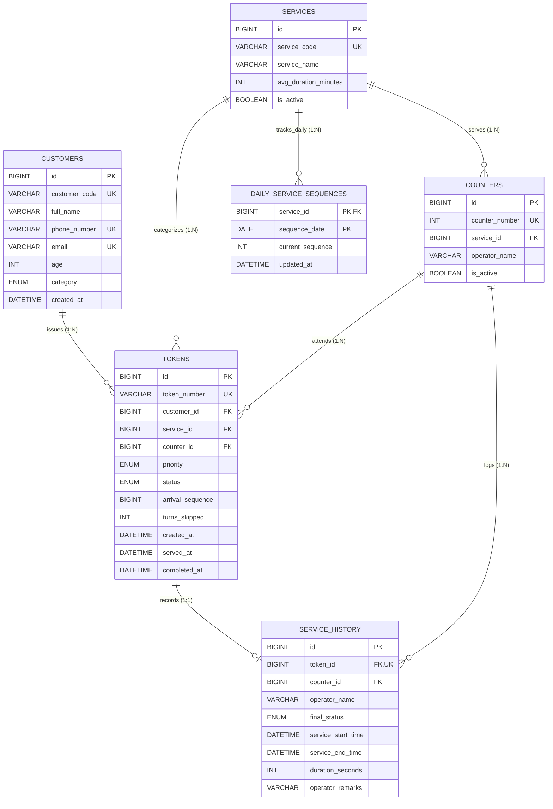
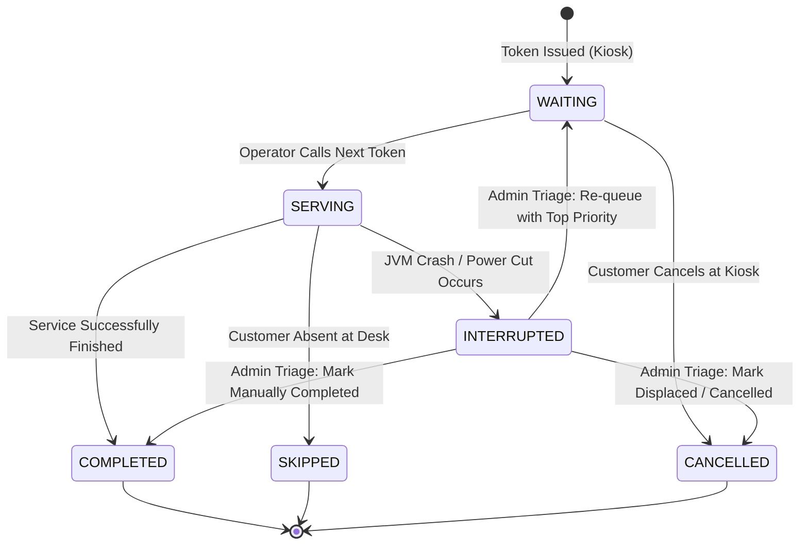

# QFlow – Database Architecture & Persistence Design
## Phase 2: Complete Relational Design, SQL Schema & Repository Contracts

**Document Version:** 1.0.0  
**Status:** DRAFT – PENDING TEAM SIGN-OFF  
**Engine:** MySQL 8.0+ (InnoDB)  
**Encoding:** `utf8mb4` / `utf8mb4_unicode_ci`  
**Transaction Isolation:** Read Committed (Default in standard InnoDB transactions)

---

## 1. Entity-Relationship (ER) Diagram & Cardinalities



### Relationship Cardinalities Explained:
1. **`CUSTOMERS` to `TOKENS` (1 : N):** A single customer can obtain multiple tokens over time, but every token is strictly bound to exactly one registered customer.
2. **`SERVICES` to `TOKENS` (1 : N):** A service category groups many tokens. A token belongs to exactly one service.
3. **`SERVICES` to `COUNTERS` (1 : N):** In our 4-counter initial setup, each counter specializes in one primary service department (e.g. Counter 1 handles Registrar, Counter 2 handles Accounts).
4. **`SERVICES` to `DAILY_SERVICE_SEQUENCES` (1 : N):** Each service has one record per calendar date to track atomic sequence increments.
5. **`COUNTERS` to `TOKENS` (1 : N):** While waiting, a token has `counter_id = NULL`. Once called, it is assigned to exactly one counter.
6. **`TOKENS` to `SERVICE_HISTORY` (1 : 1):** When a token is completed, skipped, or resolved, exactly one historical audit record is persisted.

---

## 2. 3NF Data Dictionary & Table Specifications

### 2.1 `customers`
| Column Name | Data Type | Nullable | Constraints & Defaults | Description |
| :--- | :--- | :--- | :--- | :--- |
| `id` | `BIGINT` | NO | `AUTO_INCREMENT, PRIMARY KEY` | Internal synthetic surrogate key. |
| `customer_code` | `VARCHAR(32)` | NO | `UNIQUE` | Business identifier (e.g. `CUST-2026-0001`). |
| `full_name` | `VARCHAR(100)` | NO | `CHECK (CHAR_LENGTH(TRIM) >= 2)` | Customer's full name. |
| `phone_number` | `VARCHAR(15)` | NO | `UNIQUE` | 10-digit phone number (deduplication key). |
| `email` | `VARCHAR(100)` | NO | `UNIQUE` | RFC-compliant email address. |
| `age` | `INT` | NO | `CHECK (age >= 16 AND age <= 120)` | Validated customer age. |
| `category` | `ENUM` | NO | `'STUDENT','STAFF','SENIOR_CITIZEN','GUEST'` | Demographic category for priority checks. |
| `created_at` | `DATETIME` | NO | `DEFAULT CURRENT_TIMESTAMP` | Profile creation timestamp. |
| `updated_at` | `DATETIME` | NO | `ON UPDATE CURRENT_TIMESTAMP` | Profile update timestamp. |

### 2.2 `services`
| Column Name | Data Type | Nullable | Constraints & Defaults | Description |
| :--- | :--- | :--- | :--- | :--- |
| `id` | `BIGINT` | NO | `AUTO_INCREMENT, PRIMARY KEY` | Service surrogate primary key. |
| `service_code` | `VARCHAR(10)` | NO | `UNIQUE` | Short code: `REG`, `ACC`, `ADM`, `EXM`. |
| `service_name` | `VARCHAR(100)` | NO | NOT NULL | Official service title. |
| `description` | `VARCHAR(255)` | YES | NULL | Details of services provided. |
| `avg_duration_minutes` | `INT` | NO | `DEFAULT 10, CHECK (> 0)` | Expected duration for wait-time calculation. |
| `is_active` | `BOOLEAN` | NO | `DEFAULT TRUE` | Soft-delete / active toggle. |
| `created_at` | `DATETIME` | NO | `DEFAULT CURRENT_TIMESTAMP` | Creation timestamp. |

### 2.3 `counters`
| Column Name | Data Type | Nullable | Constraints & Defaults | Description |
| :--- | :--- | :--- | :--- | :--- |
| `id` | `BIGINT` | NO | `AUTO_INCREMENT, PRIMARY KEY` | Counter primary key. |
| `counter_number` | `INT` | NO | `UNIQUE` | Physical counter station (1, 2, 3, 4). |
| `service_id` | `BIGINT` | NO | `FK -> services(id)` | Service department assigned to this desk. |
| `operator_name` | `VARCHAR(100)` | NO | NOT NULL | Name of staff member on duty. |
| `is_active` | `BOOLEAN` | NO | `DEFAULT TRUE` | Whether the desk is currently manned. |
| `created_at` | `DATETIME` | NO | `DEFAULT CURRENT_TIMESTAMP` | Setup timestamp. |

### 2.4 `daily_service_sequences`
| Column Name | Data Type | Nullable | Constraints & Defaults | Description |
| :--- | :--- | :--- | :--- | :--- |
| `service_id` | `BIGINT` | NO | `PK (Composite), FK -> services(id)` | Target service identifier. |
| `sequence_date` | `DATE` | NO | `PK (Composite)` | Current calendar date (`YYYY-MM-DD`). |
| `current_sequence` | `INT` | NO | `DEFAULT 0` | Monotonically allocated counter for the day. |
| `created_at` | `DATETIME` | NO | `DEFAULT CURRENT_TIMESTAMP` | Row creation timestamp. |
| `updated_at` | `DATETIME` | NO | `ON UPDATE CURRENT_TIMESTAMP` | Last allocation timestamp. |

### 2.5 `tokens`
| Column Name | Data Type | Nullable | Constraints & Defaults | Description |
| :--- | :--- | :--- | :--- | :--- |
| `id` | `BIGINT` | NO | `AUTO_INCREMENT, PRIMARY KEY` | Token primary key. |
| `token_number` | `VARCHAR(35)` | NO | `UNIQUE` | Format: `TKN-ACC-20261118-0001`. |
| `customer_id` | `BIGINT` | NO | `FK -> customers(id)` | Customer receiving service. |
| `service_id` | `BIGINT` | NO | `FK -> services(id)` | Service category requested. |
| `counter_id` | `BIGINT` | YES | `FK -> counters(id)` (NULL while WAITING) | Attending desk. |
| `priority` | `ENUM` | NO | `'EMERGENCY','SENIOR_CITIZEN','NORMAL'` | Scheduling priority tier. |
| `status` | `ENUM` | NO | `'WAITING','SERVING','COMPLETED','SKIPPED','CANCELLED','INTERRUPTED'` | Current lifecycle stage. |
| `arrival_sequence` | `BIGINT` | NO | NOT NULL | Global atomic counter for strict FIFO tie-breaking. |
| `turns_skipped` | `INT` | NO | `DEFAULT 0` | Incremented when higher priority overtakes this token. |
| `created_at` | `DATETIME` | NO | `DEFAULT CURRENT_TIMESTAMP` | Token issuance timestamp. |
| `served_at` | `DATETIME` | YES | NULL | Timestamp when operator called token. |
| `completed_at` | `DATETIME` | YES | NULL | Timestamp when service concluded. |

### 2.6 `service_history`
| Column Name | Data Type | Nullable | Constraints & Defaults | Description |
| :--- | :--- | :--- | :--- | :--- |
| `id` | `BIGINT` | NO | `AUTO_INCREMENT, PRIMARY KEY` | History primary key. |
| `token_id` | `BIGINT` | NO | `FK -> tokens(id)` | The serviced token. |
| `counter_id` | `BIGINT` | NO | `FK -> counters(id)` | Desk where service took place. |
| `operator_name` | `VARCHAR(100)` | NO | NOT NULL | Staff member who concluded the ticket. |
| `final_status` | `ENUM` | NO | `'COMPLETED','SKIPPED','CANCELLED','MANUALLY_RESOLVED'` | Final audited outcome. |
| `service_start_time` | `DATETIME` | NO | NOT NULL | Identical to `tokens.served_at`. |
| `service_end_time` | `DATETIME` | NO | NOT NULL | Identical to `tokens.completed_at`. |
| `duration_seconds` | `INT` | NO | NOT NULL | Actual time spent servicing customer. |
| `operator_remarks` | `VARCHAR(255)` | YES | NULL | Optional notes or resolution summary. |
| `created_at` | `DATETIME` | NO | `DEFAULT CURRENT_TIMESTAMP` | Record creation timestamp. |

---

## 3. Indexing Strategy for Performance & Recovery

| Index Name | Table | Columns | Purpose |
| :--- | :--- | :--- | :--- |
| `idx_tokens_queue_recovery` | `tokens` | `(service_id, status, priority, arrival_sequence)` | **Core index.** Enables sub-millisecond retrieval during startup recovery and queue loading. |
| `idx_tokens_status_created` | `tokens` | `(status, created_at)` | Accelerates live queue depth counts and crash triage scans for `INTERRUPTED` tokens. |
| `idx_tokens_customer` | `tokens` | `(customer_id, created_at)` | Fast lookup for customer personal token history inquiries. |
| `idx_history_dates` | `service_history` | `(service_start_time, final_status)` | Powers daily Java Stream API throughput and analytics reports. |

---

## 4. Daily Sequence Allocation & Transaction Boundary Strategy

### 4.1 Daily Sequence Allocation Pattern
To ensure token numbers reset every morning without collision:
```sql
-- Atomic allocation of next sequence for serviceId and current date
INSERT INTO daily_service_sequences (service_id, sequence_date, current_sequence)
VALUES (?, CURRENT_DATE(), 1)
ON DUPLICATE KEY UPDATE current_sequence = current_sequence + 1;

-- Retrieve allocated sequence
SELECT current_sequence 
FROM daily_service_sequences 
WHERE service_id = ? AND sequence_date = CURRENT_DATE();
```
*Note:* In JDBC, this can be executed within a single transaction block, guaranteeing no duplicate token numbers even during high concurrency bursts.

### 4.2 Token Issuance Transaction (Member 1 & Member 3)
```java
connection.setAutoCommit(false);
try {
    // 1. Allocate next sequence for the service
    int nextSeq = dailySequenceDAO.getNextSequence(connection, serviceId, LocalDate.now());
    
    // 2. Format business token number: TKN-<CODE>-<YYYYMMDD>-<0000>
    String tokenNumber = TokenGenerator.format(serviceCode, LocalDate.now(), nextSeq);
    
    // 3. Insert Token record with status = WAITING
    tokenDAO.insert(connection, token);
    
    connection.commit();
} catch (SQLException e) {
    connection.rollback();
    throw new DatabaseException("Failed to issue token", e);
} finally {
    connection.setAutoCommit(true);
}
```

### 4.3 Service Completion Transaction (Member 2 & Member 3)
```java
connection.setAutoCommit(false);
try {
    // 1. Update Token status to COMPLETED and set completed_at
    tokenDAO.markCompleted(connection, tokenId, completedAt);
    
    // 2. Insert immutable service_history record
    serviceHistoryDAO.insert(connection, historyRecord);
    
    connection.commit();
} catch (SQLException e) {
    connection.rollback();
    throw new DatabaseException("Failed to complete service transaction", e);
} finally {
    connection.setAutoCommit(true);
}
```

---

## 5. Token Lifecycle & State Machine



---

## 6. Critical SQL Queries (Prepared Statements)

### 6.1 Queue Rehydration on Startup
Fetches pending tokens partitioned by service, sorted by priority and arrival sequence:
```sql
SELECT t.id, t.token_number, t.customer_id, t.service_id, t.counter_id, 
       t.priority, t.status, t.arrival_sequence, t.turns_skipped, 
       t.created_at, t.served_at, t.completed_at
FROM tokens t
WHERE t.service_id = ? AND t.status = 'WAITING'
ORDER BY 
    CASE t.priority 
        WHEN 'EMERGENCY' THEN 1 
        WHEN 'SENIOR_CITIZEN' THEN 2 
        WHEN 'NORMAL' THEN 3 
    END ASC,
    t.arrival_sequence ASC;
```

### 6.2 Atomic Token Claiming (Counter Dispatch)
Optimistic locking ensures two operators never claim the same customer simultaneously:
```sql
UPDATE tokens 
SET status = 'SERVING', 
    counter_id = ?, 
    served_at = CURRENT_TIMESTAMP() 
WHERE id = ? AND status = 'WAITING';
```
*(JDBC checks `executeUpdate() == 1`; if 0, another counter claimed the token).*

### 6.3 Startup Crash Triage Query
Detects tokens left in `SERVING` state prior to the crash:
```sql
SELECT t.id, t.token_number, t.customer_id, t.service_id, t.counter_id, 
       t.priority, t.created_at, t.served_at
FROM tokens t
WHERE t.status = 'SERVING';
```

---

## 7. Frozen Repository Contracts & Generic Interfaces

These Java interfaces are **frozen contracts**. All four team members will build against these signatures.

### 7.1 Generic Base Interface: `CrudRepository<T, ID>`
```java
package com.qflow.repository;

import java.util.List;
import java.util.Optional;

public interface CrudRepository<T, ID> {
    T save(T entity);
    Optional<T> findById(ID id);
    List<T> findAll();
    boolean update(T entity);
    boolean deleteById(ID id);
}
```

### 7.2 `CustomerRepository` (Member 1 & 3)
```java
package com.qflow.repository;

import com.qflow.model.Customer;
import java.util.Optional;

public interface CustomerRepository extends CrudRepository<Customer, Long> {
    Optional<Customer> findByPhoneNumber(String phoneNumber);
    Optional<Customer> findByEmail(String email);
    Optional<Customer> findByCustomerCode(String customerCode);
    boolean existsByPhoneNumber(String phoneNumber);
}
```

### 7.3 `DailySequenceRepository` (Member 1, 2 & 3)
```java
package com.qflow.repository;

import java.sql.Connection;
import java.time.LocalDate;

public interface DailySequenceRepository {
    int getNextSequence(Connection conn, Long serviceId, LocalDate date);
    int getCurrentSequence(Long serviceId, LocalDate date);
}
```

### 7.4 `TokenRepository` (Member 1, 2, 3 & 4)
```java
package com.qflow.repository;

import com.qflow.model.Token;
import com.qflow.model.enums.TokenStatus;
import java.sql.Connection;
import java.time.LocalDateTime;
import java.util.List;
import java.util.Optional;

public interface TokenRepository extends CrudRepository<Token, Long> {
    Optional<Token> findByTokenNumber(String tokenNumber);
    List<Token> findWaitingTokensByService(Long serviceId);
    List<Token> findTokensByCustomer(Long customerId);
    List<Token> findInterruptedTokens();
    
    // Atomic status mutations
    boolean claimToken(Long tokenId, Long counterId);
    boolean updateStatus(Long tokenId, TokenStatus newStatus);
    boolean completeService(Connection conn, Long tokenId, LocalDateTime completedAt);
    void batchUpdateTurnsSkipped(List<Long> tokenIds);
}
```

### 7.5 `ServiceHistoryRepository` (Member 3 & 4)
```java
package com.qflow.repository;

import com.qflow.model.ServiceHistory;
import java.sql.Connection;
import java.time.LocalDate;
import java.util.List;

public interface ServiceHistoryRepository extends CrudRepository<ServiceHistory, Long> {
    ServiceHistory recordCompletion(Connection conn, ServiceHistory history);
    List<ServiceHistory> findByDateRange(LocalDate startDate, LocalDate endDate);
    List<ServiceHistory> findByServiceId(Long serviceId);
    List<ServiceHistory> findByCounterId(Long counterId);
}
```

---

## 8. Phase 2 Review Checklist

- [ ] **1. ER Diagram & Normalization:** 3NF schema verified; no transitive functional dependencies.
- [ ] **2. Data Types & Constraints:** Sizing, `ENUM` declarations, and `CHECK` constraints validated.
- [ ] **3. Indexes:** Query performance indexes on `tokens` and `service_history` confirmed.
- [ ] **4. Daily Sequences:** Atomic persistent allocation via `daily_service_sequences` approved.
- [ ] **5. Token Lifecycle & Recovery:** Interrupted token state machine and admin triage verified.
- [ ] **6. Critical Queries:** Prepared statement templates for claiming, recovery, and completion accepted.
- [ ] **7. Repository Contracts:** Shared generic interfaces locked for parallel implementation.
